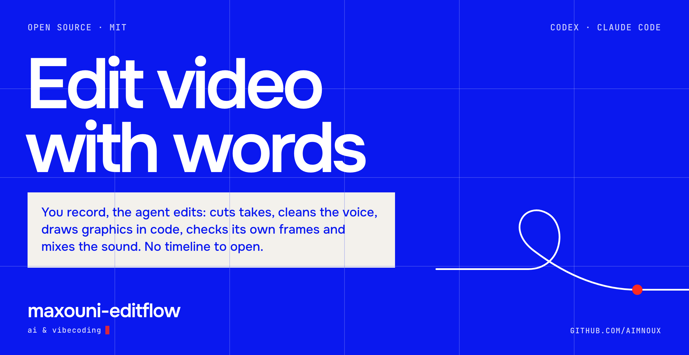
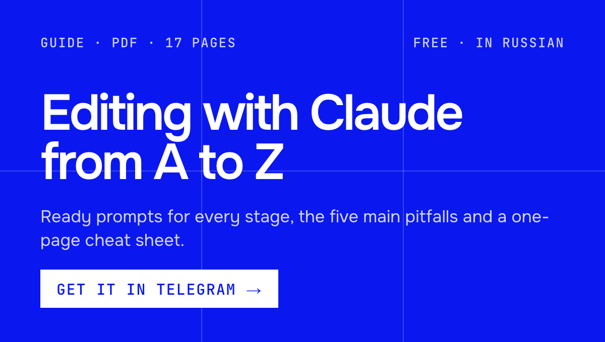
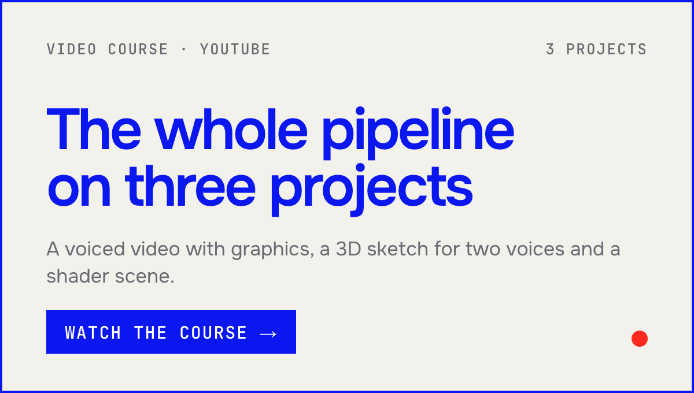
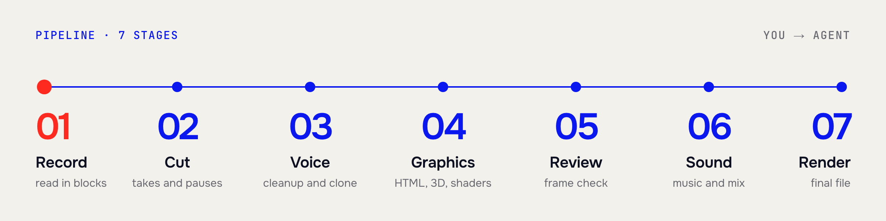
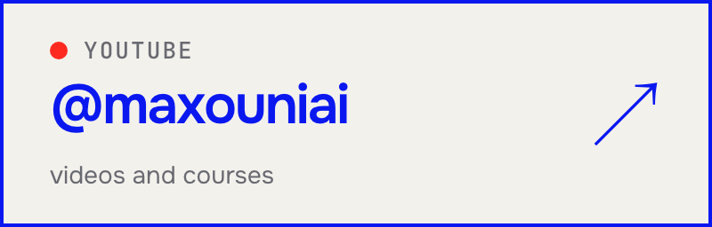
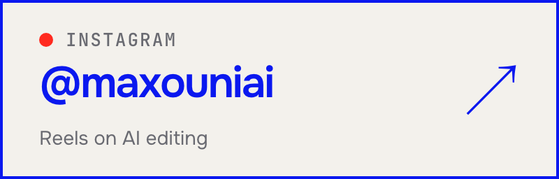

<p align="center">
  
</p>

<p align="center">
  <b>English</b> · <a href="README.ru.md">Русский</a>
</p>

A starter kit for editing video with **Codex** or **Claude Code**. You record your voice, the agent edits: it cuts takes and pauses, cleans the sound, draws graphics in code, checks its own frames, mixes the music and renders the final file. You ask for changes in plain words. You never open a timeline.

<p align="center">
  <a href="https://t.me/maxouniai_bot?start=montage-gh-readme"></a>
  <a href="https://www.youtube.com/@maxouniai"></a>
</p>

<p align="center"><sub>The guide and the course are in Russian.</sub></p>

<p align="center">
  
</p>

## How it works

1. **Install the kit** with one command (below).
2. **Open the folder** in Codex or Claude Code.
3. **Say what you want** in plain words:

| You say | The agent |
|---|---|
| "set up my style" | interviews you and writes your visual style file |
| "here is my recording, cut it" | removes bad takes, pauses and filler, shows you the cut |
| "clean the voice" | cleans the recording; optionally clones your voice for retakes |
| "draw graphics for chapter 2" | writes scenes in code: titles, charts, transitions |
| "make a vertical from this text" | builds one 9:16 video for Shorts, Reels and TikTok |
| "check and render" | a second agent reviews frames against a checklist, then the final render |

There is no visual style inside, on purpose. The kit gives you the bones; your own look you grow with the agent, session by session.

## What it does

| Stage | What happens | Skill |
|---|---|---|
| ✂️ **Cut** | Bad takes, pauses and filler leave the recording | `cut` |
| 🎙 **Voice** | Cleanup, a clone of your voice for retakes, two voices with intonation tags for a sketch | `voice` |
| 🎨 **Graphics** | Titles, charts and transitions written as code on [HyperFrames](https://hyperframes.heygen.com) (HTML + GSAP), not clicked together | `graphics` |
| 🧊 **3D and shaders** | three.js scenes and pure WebGL worlds with motion blur, depth of field and soft shadows | `3d` |
| 👀 **Review** | A second agent checks sampled frames and transitions against a checklist before you see anything | `review` |
| 🔊 **Sound** | Music, effects and the mix | `sound` |
| 🎬 **Render** | The final file, ready to upload | `render` |

**Two formats:** horizontal 16:9 and vertical 9:16. A vertical is built once for every platform; the ending is a parameter, not a branch of code.

> [!NOTE]
> Not a video editor and not a plugin for one. Not a model, not a service, no account. It is a repository you open in Codex or Claude Code and talk to.

## Install

**Required:** Codex or [Claude Code](https://claude.com/claude-code), git, Python 3.11–3.13, Node.js 22.12+ and ffmpeg (including ffprobe).
**Optional:** an [ElevenLabs](https://elevenlabs.io) key — speech-to-text for the cut, voice cloning and music.

```bash
git clone https://github.com/aimnoux/maxouni-editflow.git
cd maxouni-editflow
bash setup.sh
source .venv/bin/activate
```

Put your ElevenLabs key into `.env` if you have one. Then open the folder in your agent and ask for the first thing you need.

> [!TIP]
> Check the install for free: `python engine/demo.py` renders a draft demo video with no AI and no paid services. The result is `engine/renders/demo/demo.mp4`.

<details>
<summary><b>What <code>setup.sh</code> does</b></summary>
<br>

It checks the required tools, creates a local `.venv` (or uses your already activated Python virtual environment) and installs Python packages there, creates `.env` from `.env.example`, installs JavaScript dependencies with `npm ci` from `package-lock.json`, checks generated skills, fetches pinned GSAP and downloads the dedicated browser through `node engine/hf.mjs browser ensure`.

It exits with an error if a required step fails. It does not install Python packages globally or run a render.

Activate the virtual environment before running Python scripts or opening your agent from the terminal, so child commands inherit its `PATH`. If you used an existing environment, keep that one active instead. Rendering does not require an ElevenLabs key; speech-to-text, cloning and music generation call paid APIs only when you request them.
</details>

<details>
<summary><b>Windows, Linux and the render browser</b></summary>
<br>

The kit was built and verified on macOS. Linux and Windows have not been fully tested. Windows needs Git Bash, native Python/Node.js and ffmpeg on `PATH`; activate with `source .venv/Scripts/activate`.

Rendering uses a dedicated `chrome-headless-shell`; your personal Google Chrome is not used. The pinned browser download does not support Linux ARM64: provide a compatible `chrome-headless-shell` via `CHROME_PATH` in `.env`; setup will not install system Chromium. Older systems may also need a compatible build.

Browser lookup order: `CHROME_PATH`, the HyperFrames cache (`~/.cache/hyperframes/chrome/chrome-headless-shell/`), Puppeteer's cache (`PUPPETEER_CACHE_DIR` or `~/.cache/puppeteer`). Only `chrome-headless-shell` executables are accepted, including symlink targets. Each command uses an isolated temporary profile and cleans up its browser; the HyperFrames warm daemon is disabled.
</details>

## Recording and script format

A live recording may be audio or video. The cut writes `voice.wav` for audio-only input and `rough.mp4` for video, plus `words.json` and `edl.json`. Horizontal videos then get chapter padding; vertical videos take the cut directory directly with `vertical.py build ... --cut <dir>`.

Speech lives under `### N.M` headings:

```markdown
### 1.1
A paragraph is read as one piece, even when
it wraps across several source lines.

A blank line between paragraphs is a pause.

> A note to yourself. Quotes, tables and headings are not spoken.
```

Vertical batches use `N.0` for recording slates, `N.8` for the YouTube ending and `N.9` for the Instagram/TikTok ending.

## 3D and shaders

| Task | Skill | Draws with | Render |
|---|---|---|---|
| Things, characters, rooms; a 9:16 sketch with two voices | `3d`, `voice`, `vertical` | three.js r181 (vendored, MIT) | `engine/render3d.mjs` |
| A world written as a fragment shader, built on the beats of a track | `3d` | WebGL2 | `engine/render3d.mjs` |

> [!IMPORTANT]
> **A video card is required.** macOS with Metal is verified; Windows and Linux have not been tested. `node engine/render3d.mjs --doctor` says what the browser gets, and the render stops with a clear message when there is no GPU.

Examples, no paid calls:

```bash
python engine/vertical.py build vertical/sketch.md 1 yt --estimate
node engine/render3d.mjs sketch-s1-yt --draft
node engine/render3d.mjs scenes/shader-example/index.html --draft
```

## What is inside

```
.agents/skills/    skills: edit, cut, voice, graphics, 3d, vertical, review, sound, render, style
engine/            scripts (Python, Node) and a small library for compositions, no style in it
style/             your style: templates you fill in with the agent
videos/<slug>/     a horizontal video: script, settings; recordings and voice are not in git
vertical/          vertical videos: one text file per batch
AGENTS.md          shared instructions for both agents
CLAUDE.md          short Claude entry point; .claude/skills/ is a generated copy
```

## For developers

<details>
<summary><b>Free local demo</b></summary>
<br>

`python engine/demo.py` uses the existing vertical example, generates deterministic word tones and timestamps locally, then renders one 10 fps draft with one dedicated browser worker. The result is `engine/renders/demo/demo.mp4`; logs stay in `engine/build/demo/`. There are no AI, ElevenLabs or paid service calls; tones are a test fixture, not speech. `--prepare-only` builds audio, timing and HTML without a browser. Setup's first dependency, browser and GSAP downloads need a network. The demo shows the neutral template without choosing your production style.
</details>

<details>
<summary><b>Instructions and offline checks</b></summary>
<br>

`AGENTS.md` and `.agents/skills/` are the only instruction sources. After editing a skill run `python engine/sync_skills.py`; it generates ordinary files in `.claude/skills/`, including references, without symlinks. `python engine/sync_skills.py --check` fails on drift without writing anything. Load only the routed skill; the full 65-code checklist is a reviewer-only reference.

`python -m unittest discover -s tests -v` runs synthetic media and mocked service/browser regressions. `python engine/contracts.py --json` emits deterministic, versioned parsing, trigger, audio-envelope and review-binding probes. Neither command requires a sibling repository, API key or live service.

Python packages are pinned in `requirements.txt`; Node dependencies and integrity hashes live in `package-lock.json`. Refresh them deliberately together with the regression checks. Python 3.11–3.13 is the supported range; the full local smoke was run on Python 3.13/macOS.
</details>

<details>
<summary><b>Verify once, reuse the evidence</b></summary>
<br>

`python engine/verify.py <composition-id>` runs runtime and HyperFrames checks and prepares the frame-review sheets in one command (`--project <slug>` checks a project; `--video out.mp4` also checks the render). Unchanged inputs reuse cached evidence and a recorded reviewer conclusion, saving browser launches and repeated frame capture. Changed inputs invalidate the cache. A machine pass still needs an independent visual verdict before the result is shown; `--force` requests a fresh pass.
</details>

## Author

I build projects, edit videos and automate things with Claude and Codex, and show how it works from the inside. Guides, prompts and materials for every video are free in Telegram.

<p align="center">
  <a href="https://t.me/maxouniai"></a>
  <a href="https://www.youtube.com/@maxouniai"></a>
  <a href="https://www.instagram.com/maxouniai/"></a>
</p>

---

MIT license. If the kit helped, leave a ⭐ so others can find it.
