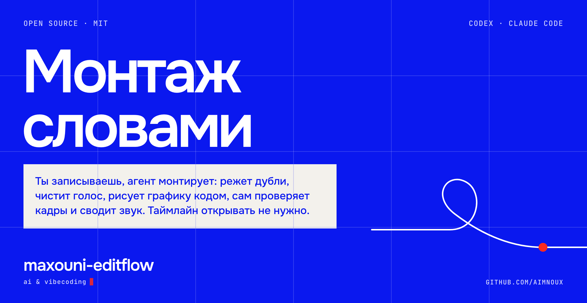
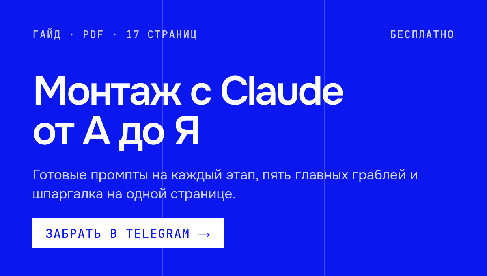
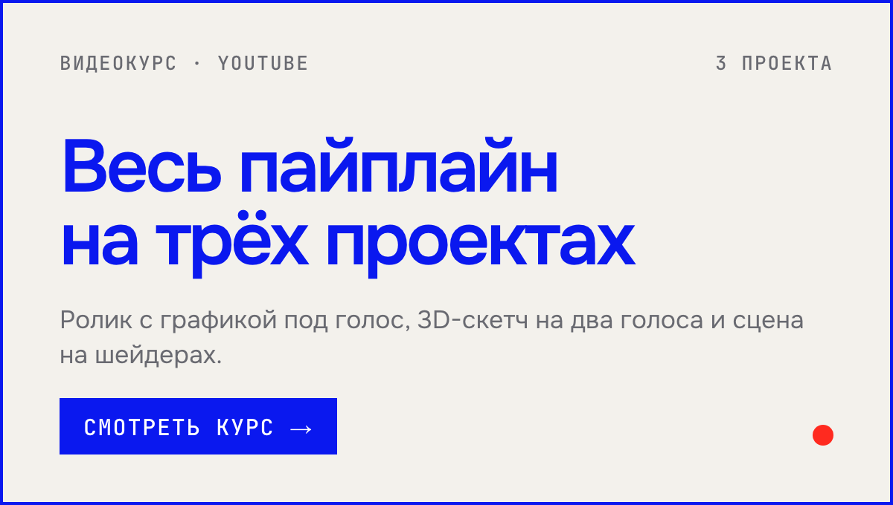
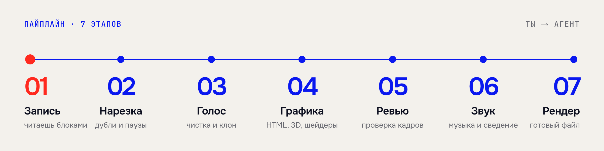
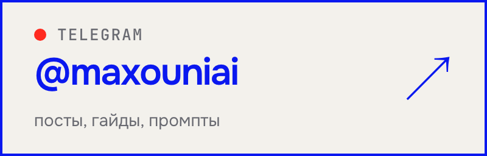
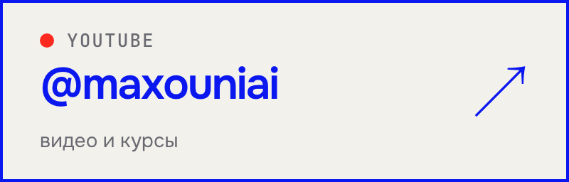
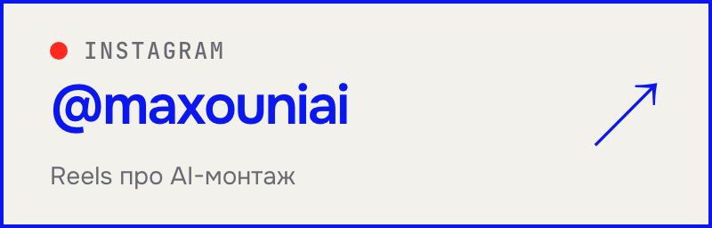

<p align="center">
  
</p>

<p align="center">
  <a href="README.md">English</a> · <b>Русский</b>
</p>

Стартовый набор для монтажа видео с **Codex** или **Claude Code**. Ты записываешь голос, агент монтирует: режет дубли и паузы, чистит звук, рисует графику кодом, сам проверяет кадры, сводит музыку и рендерит готовый файл. Ты говоришь, что поправить, словами. Таймлайн открывать не нужно.

<p align="center">
  <a href="https://t.me/maxouniai_bot?start=montage-gh-readme"></a>
  <a href="https://youtu.be/E6ioDmxAl1U"></a>
</p>

<p align="center">
  
</p>

## Как это работает

1. **Ставишь набор** одной командой (ниже).
2. **Открываешь папку** в Codex или Claude Code.
3. **Говоришь, что нужно** обычными словами:

| Ты пишешь | Что делает агент |
|---|---|
| «собери мой стиль» | расспрашивает тебя и записывает файл твоего визуального стиля |
| «вот запись, нарежь» | убирает плохие дубли, паузы и мусор, показывает нарезку |
| «почисти голос» | чистит запись; по желанию клонирует голос для переписанных фраз |
| «нарисуй графику под главу 2» | пишет сцены кодом: титры, схемы, переходы |
| «сделай вертикалку по этому тексту» | собирает 9:16 сразу для Shorts, Reels и TikTok |
| «проверь и отрендери» | второй агент смотрит кадры по чек-листу, потом финальный рендер |

Визуального стиля внутри нет, и это специально. Набор даёт костяк, а свой вид ты наращиваешь с агентом сессия за сессией.

## Что умеет

| Этап | Что происходит | Скилл |
|---|---|---|
| ✂️ **Нарезка** | Плохие дубли, паузы и мусор уходят из записи | `cut` |
| 🎙 **Голос** | Чистка, клон твоего голоса для правок, два голоса с тегами интонаций для скетча | `voice` |
| 🎨 **Графика** | Титры, схемы и переходы пишутся кодом на [HyperFrames](https://hyperframes.heygen.com) (HTML + GSAP), а не накликиваются | `graphics` |
| 🧊 **3D и шейдеры** | Сцены three.js и миры на чистом WebGL: смаз, глубина резкости, мягкие тени | `3d` |
| 👀 **Ревью** | Второй агент проверяет выборку кадров и переходы по чек-листу, прежде чем ты увидишь результат | `review` |
| 🔊 **Звук** | Музыка, эффекты и сведение | `sound` |
| 🎬 **Рендер** | Готовый файл для загрузки | `render` |

**Два формата:** горизонтальный 16:9 и вертикальный 9:16. Вертикалка собирается один раз для всех площадок, концовка под площадку — параметр, а не отдельная ветка кода.

> [!NOTE]
> Это не видеоредактор и не плагин к нему. Не модель, не сервис, аккаунт не нужен. Это репозиторий, который ты открываешь в Codex или Claude Code и с которым разговариваешь.

## Установка

**Нужно:** Codex или [Claude Code](https://claude.com/claude-code), git, Python 3.11–3.13, Node.js 22.12+ и ffmpeg (вместе с ffprobe).
**По желанию:** ключ [ElevenLabs](https://elevenlabs.io) — распознавание речи для нарезки, клон голоса и музыка.

```bash
git clone https://github.com/aimnoux/maxouni-editflow.git
cd maxouni-editflow
bash setup.sh
source .venv/bin/activate
```

Если есть ключ ElevenLabs, впиши его в `.env`. Дальше открой папку в агенте и попроси первое, что нужно.

> [!TIP]
> Проверить, что всё встало, можно бесплатно: `python engine/demo.py` соберёт черновое демо-видео без AI и платных сервисов. Результат — `engine/renders/demo/demo.mp4`.

<details>
<summary><b>Что делает <code>setup.sh</code></b></summary>
<br>

Проверяет инструменты, создаёт локальную `.venv` (или использует уже активированное окружение Python) и ставит пакеты туда, создаёт `.env` из `.env.example`, ставит JavaScript-зависимости через `npm ci` по `package-lock.json`, проверяет копии скиллов, загружает закреплённый GSAP и скачивает отдельный браузер командой `node engine/hf.mjs browser ensure`.

Если обязательный шаг не прошёл, скрипт завершается с ошибкой. Глобально пакеты Python не ставятся, рендер не запускается.

Перед запуском Python-скриптов и агента из терминала активируй окружение: дочерние команды получают его `PATH`. Если использовал своё окружение, оставь активным его. Для рендера ключ ElevenLabs не нужен; распознавание речи, клон и генерация музыки обращаются к платному API, только когда ты их запрашиваешь.
</details>

<details>
<summary><b>Windows, Linux и браузер для рендера</b></summary>
<br>

Набор собран и проверен на macOS. Linux и Windows полностью не проверены. На Windows нужны Git Bash, нативные Python/Node.js и ffmpeg в `PATH`; окружение активируется командой `source .venv/Scripts/activate`.

Для рендера используется отдельный `chrome-headless-shell`, личный Google Chrome не трогается. Закреплённая загрузка браузера не поддерживает Linux ARM64: укажи совместимый `chrome-headless-shell` в `CHROME_PATH` в `.env`, системный Chromium setup не ставит. На старых системах тоже может понадобиться совместимая сборка.

Браузер ищется по порядку: `CHROME_PATH`, кэш HyperFrames (`~/.cache/hyperframes/chrome/chrome-headless-shell/`), кэш Puppeteer (`PUPPETEER_CACHE_DIR` или `~/.cache/puppeteer`). Принимаются только исполняемые `chrome-headless-shell`, включая цели симлинков. Каждая команда работает с изолированным временным профилем и закрывает свой браузер; тёплый демон HyperFrames отключён.
</details>

## Запись и сценарий

Живая запись может быть аудио или видео. Нарезка пишет `voice.wav` для аудио и `rough.mp4` для видео, плюс `words.json` и `edl.json`. Горизонтальные видео дальше получают отступы глав; вертикальные берут папку нарезки напрямую: `vertical.py build ... --cut <dir>`.

Речь лежит под заголовками `### N.M`:

```markdown
### 1.1
Первый абзац читается подряд, даже если в файле
он перенесён на несколько строк.

Пустая строка между абзацами — это пауза.

> Заметка себе. Цитаты, таблицы и заголовки не озвучиваются.
```

В пачках вертикалок `N.0` — хлопушка для записи, `N.8` — концовка для YouTube, `N.9` — для Instagram и TikTok.

## 3D и шейдеры

| Задача | Скилл | Чем рисуется | Рендер |
|---|---|---|---|
| Предметы, персонажи, комнаты; скетч 9:16 на два голоса | `3d`, `voice`, `vertical` | three.js r181 (в комплекте, MIT) | `engine/render3d.mjs` |
| Мир, написанный фрагментным шейдером, собранный по ударам трека | `3d` | WebGL2 | `engine/render3d.mjs` |

> [!IMPORTANT]
> **Нужна видеокарта.** Проверено на macOS с Metal; Windows и Linux не проверялись. `node engine/render3d.mjs --doctor` покажет, что получает браузер, а без GPU рендер остановится с понятным сообщением.

Примеры без платных вызовов:

```bash
python engine/vertical.py build vertical/sketch.md 1 yt --estimate
node engine/render3d.mjs sketch-s1-yt --draft
node engine/render3d.mjs scenes/shader-example/index.html --draft
```

## Что внутри

```
.agents/skills/    скиллы: edit, cut, voice, graphics, 3d, vertical, review, sound, render, style
engine/            скрипты (Python, Node) и небольшая библиотека композиций, без стиля
style/             твой стиль: шаблоны, которые заполняются вместе с агентом
videos/<slug>/     горизонтальное видео: сценарий и настройки; записи и голос не в git
vertical/          вертикалки: один текстовый файл на пачку
AGENTS.md          общие инструкции для обоих агентов
CLAUDE.md          короткий вход для Claude; .claude/skills/ — генерируемая копия
```

## Для разработчиков

<details>
<summary><b>Бесплатное демо</b></summary>
<br>

`python engine/demo.py` берёт пример вертикалки, локально генерирует детерминированные тона вместо слов и тайминги, затем рендерит один черновик 10 fps одним выделенным браузером. Результат — `engine/renders/demo/demo.mp4`, логи — `engine/build/demo/`. Никаких AI, ElevenLabs и платных сервисов; тоны — тестовая заглушка, а не речь. `--prepare-only` собирает звук, тайминги и HTML без браузера. Первые загрузки зависимостей, браузера и GSAP при установке требуют сеть. Демо показывает нейтральный шаблон и не выбирает за тебя стиль.
</details>

<details>
<summary><b>Инструкции и офлайн-проверки</b></summary>
<br>

`AGENTS.md` и `.agents/skills/` — единственные источники инструкций. После правки скилла запусти `python engine/sync_skills.py`: он генерирует обычные файлы в `.claude/skills/` вместе со справочниками, без симлинков. `python engine/sync_skills.py --check` падает при расхождении и ничего не пишет. Грузится только нужный скилл; полный чек-лист из 65 кодов — справочник только для ревьюера.

`python -m unittest discover -s tests -v` гоняет регрессии на синтетических медиа с подменёнными сервисами и браузером. `python engine/contracts.py --json` выдаёт детерминированные версионированные пробы разбора, триггеров, огибающей звука и привязки ревью. Обеим командам не нужны соседний репозиторий, ключ API или живой сервис.

Python-пакеты закреплены в `requirements.txt`, Node-зависимости и хеши целостности — в `package-lock.json`. Обновляй их осознанно вместе с регрессионными проверками. Поддерживается Python 3.11–3.13; полный локальный прогон выполнен на Python 3.13 и macOS.
</details>

<details>
<summary><b>Проверка один раз, повтор по свидетельству</b></summary>
<br>

`python engine/verify.py <composition-id>` одной командой запускает проверки рантайма и HyperFrames и готовит листы кадров для ревью (`--project <slug>` проверяет проект, `--video out.mp4` — ещё и рендер). Неизменённые входы берут закэшированное свидетельство и записанный вывод ревьюера, экономя запуски браузера и повторный захват кадров. Изменённые входы сбрасывают кэш. Машинный успех всё равно требует независимого визуального вердикта, прежде чем результат покажут тебе; `--force` запрашивает свежий прогон.
</details>

## Автор

Делаю проекты, монтаж и автоматизации с Claude и Codex и показываю, как это устроено изнутри. Гайды, промпты и материалы к видео бесплатно лежат в Telegram.

<p align="center">
  <a href="https://t.me/maxouniai"></a>
  <a href="https://www.youtube.com/@maxouniai"></a>
  <a href="https://www.instagram.com/maxouniai/"></a>
</p>

---

Лицензия MIT. Если набор пригодился, поставь ⭐ — так его найдут другие.
